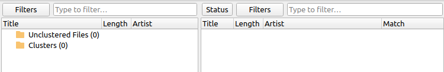

.. MusicBrainz Picard Documentation Project

:index:`Filtering the Main Screen <user interface; main screen filtering>`
===========================================================================

The items displayed in the Cluster Pane and the Album Pane can be filtered to allow for quickly reviewing selected information. The filter bars can be displayed or hidden from the :menuselection:`"View"` menu, or using the keyboard shortcut :kbd:`Ctrl+Shift+F`.

To filter the items in one of the panes, simply select one or more filters and enter the filter text to use for that pane. The items will be displayed or hidden based on the filter criteria entered.

Text Filters
------------

When the :guilabel:`Filters` button is clicked, a dialog will be displayed to allow you to select the filters to use for that pane.

.. only:: not latex

   .. image:: images/filter_selection_dialog.png

.. only:: latex

   .. image:: images/filter_selection_dialog.png
      :width: 30%

When filtering is applied, items will only be displayed if:

- no filters are selected or no filter text has been entered;
- no tags are found that match the selected filters;
- a tag is found that matches one of the selected filters and the filter text is found within the tag value.

Items will not be displayed if one or more tags were found in the selected filters and the filter text was not found in any values of those tags.

Status Filters
--------------

In the Album Pane, albums can be filtered based on their modified and/or complete status. When the :guilabel:`Status` button is clicked, a menu will be displayed to allow you to select the status types to display.

.. only:: not latex

   .. image:: images/status_filter_selection_menu.png
      :alt: Status filter menu

.. only:: latex

   .. image:: images/status_filter_selection_menu.png
      :width: 30%
      :alt: Status filter menu

The list of filterable status types are as follows:

.. list-table::
   :header-rows: 1

   * - Status
     - Description
   * - Modified
     - Album has pending modifications
   * - Unmodified
     - Album has no pending modifications
   * - Complete
     - Album has a single file assigned to each track
   * - Incomplete
     - Album has one or more tracks with no file assigned or multiple files assigned

When status filtering is applied, album items will only be displayed if both their modified and complete status match one of the selected status types. For example, if an album has a single audio file assigned to each track and there are differences in the metadata between the files and tracks such that changes will be made to the tags when saving, then the album will only be displayed if both the **Complete** and **Modified** status types are selected. In this case selecting either or both of the **Modified** and **Incomplete** status codes has no impact on the display of the album.

.. note::

   Unchecking both the **Modified** and **Unmodified** status types will cause all albums to be filtered out. Similarly, unchecking both **Complete** and **Incomplete** status types will cause all albums to be filtered out as well.
