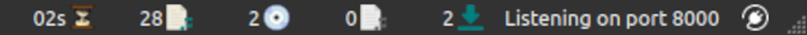

.. MusicBrainz Picard Documentation Project

:index:`Status Icons <icons; status>`
=====================================

When albums and tracks are displayed in the right-hand pane, each line begins with an icon to indicate the status of the item.

:index:`Album / Release Icons <icons; album, icons; release>`
-------------------------------------------------------------

|img-release|

   | This icon indicates that the information for the release has been successfully retrieved from the MusicBrainz database. Some, but not all, tracks may have been matched to files and the information has not been modified.
   |

|img-release-modified|

   | This icon indicates that some of the tracks have been matched and that the information for the release has been modified.
   |

|img-release-matched|

   | This icon indicates that all of the tracks have been matched and that the information has not been modified.
   |

|img-release-matched-modified|

   | This icon indicates that all of the tracks have been matched and that the information for the release has been modified.
   |

|img-release-error|

   | This icon indicates that Picard has encountered an error with the release, typically while retrieving the information from the MusicBrainz database.
   |

:index:`Track Icons <icons; track>`
------------------------------------

|img-track-audio|

   | This icon indicates that the track is an audio track and that there is no single file currently matched. This appears if there is no file matched, or if there are multiple files matched.
   |

|img-track-video|

   | This icon indicates that the track is a video track and that there is no file currently matched. This appears if there is no file matched, or if there are multiple files matched.
   |

|img-track-data|

   | This icon indicates that the track is a data track and that there is no file currently matched. This appears if there is no file matched, or if there are multiple files matched.
   |

|img-match-0| |img-match-1| |img-match-2| |img-match-3| |img-match-4| |img-match-5| (Normal)

|img-match-pending-0| |img-match-pending-1| |img-match-pending-2| |img-match-pending-3| |img-match-pending-4| |img-match-pending-5| (Pending)

   | These icons appear for a track that has a single matched file, and indicate how closely the metadata currently assigned to the track corresponds to the metadata from the matched audio file saved on disk. The fill grows and shifts from red toward green as the match improves. The icons are divided into six levels: a leftmost red level for a poor match, four intermediate levels, and a fully green level that is shown only for an exact match.
   |
   | Because this reflects the *pending* differences between the track metadata and the metadata for the audio file stored on disk, a track with unsaved changes shows one of these match icons rather than the saved indicator, even when the match is a perfect green. Once the file is saved (so that the loaded metadata and the metadata in the audio file on disk are identical) the icon changes to the saved indicator described below.
   |
   | The icons are displayed dimmed (the *Pending* row above) when there is a pending action for the track, such as the file being queued for saving.
   |

|img-track-saved|

   | This icon indicates that the matched file has no unsaved changes: the data loaded in Picard is identical to the data stored on disk (for example, right after the file has been saved). This is different from a fully green match icon, which marks a *perfect match that still has unsaved changes* pending.
   |

|img-error-no-access|

   | This icon indicates that Picard encountered a permission error while trying to load or save the file. This is typically due to the file being marked as read-only, or you do not have sufficient permission to read the file or save the file in the specified directory.
   |

|img-error-not-found|

   | This icon indicates that Picard could not find the file with the given path while trying to load or save the track. This is typically due to the file being moved or deleted since it was loaded into Picard, but could also be due to a missing directory.
   |

|img-dialog-error|

   This icon indicates that Picard encountered an error while trying to load or save the track. This is typically due to a problem writing the tags into the file, but could also be due to a storage IO error on your system.

:index:`Status Bar <icons; status bar, status bar>`
--------------------------------------------------------

There is a status bar at the bottom of Picard's main screen, which displays some information about current processing status. This includes four numbers along with the current port number that Picard is monitoring, and a notification icon if there are any plugin updates available. In addition, if Picard is currently processing your files an estimated time to completion will also be displayed to the left of the status indicators.

From left to right, the numbers represent:

1. The estimated processing time remaining (only displayed if Picard is actively processing files).
2. The number of files loaded.
3. The number of MusicBrainz releases loaded.
4. The number of files with pending action (e.g. loading, saving, fingerprinting).
5. The number of active network requests.

If there are any plugin updates available and the notification icon is displayed, clicking the icon will open the Plugins options page where you can review the available plugin updates and select which ones to install.

.. raw:: latex

   \clearpage
